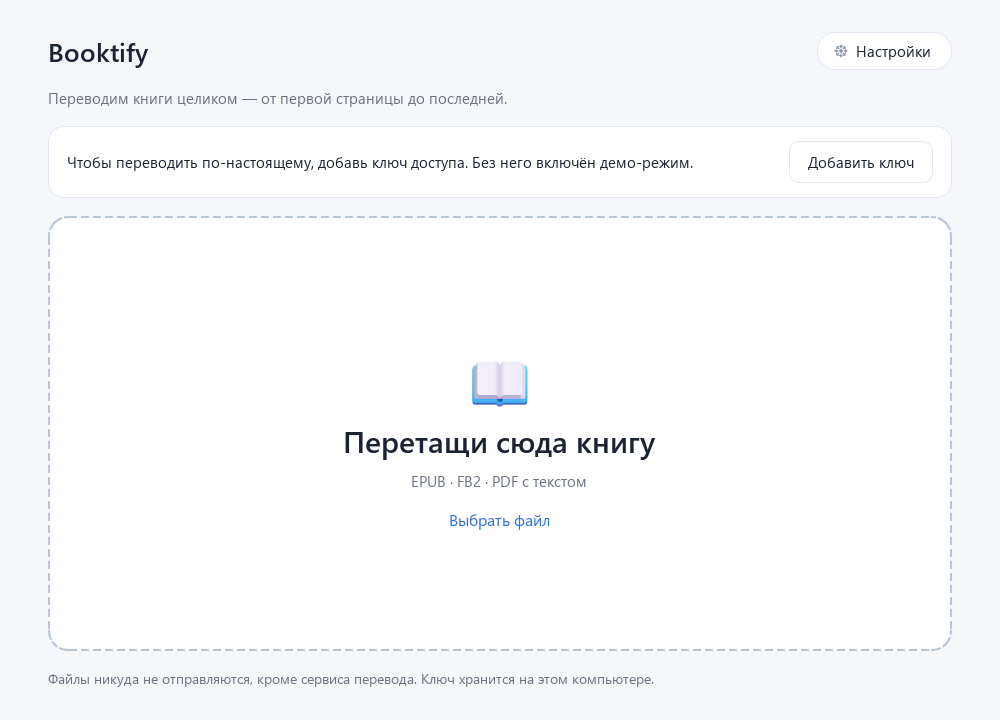
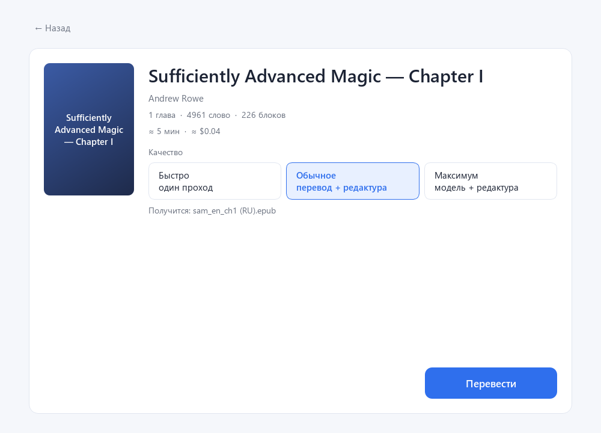
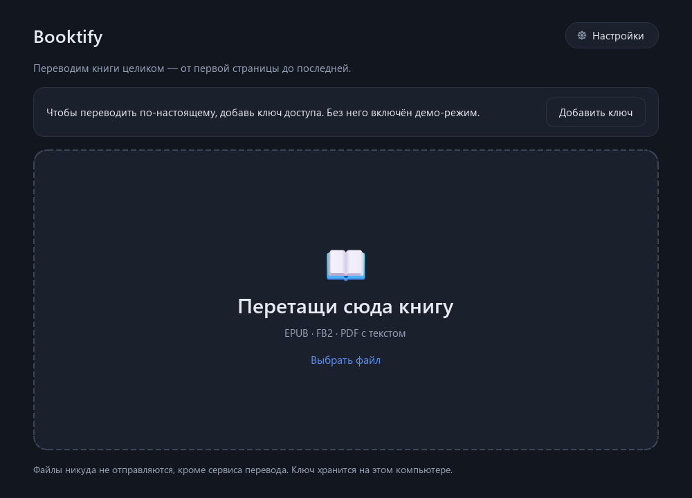

# Booktify

Кидаешь книгу на английском — забираешь готовый EPUB на русском. Перевод делает
модель, подключённая по API-ключу; глоссарий держит имена и термины одинаковыми
во всей книге.



## Скачать

Два варианта, оба лежат в [Releases](https://github.com/9leywin/booktify/releases/latest) —
выбирай, как удобнее ставить:

| Вариант | Файл | Кому подойдёт |
|---|---|---|
| **Установщик** | [`Booktify-1.0.0-setup.exe`](https://github.com/9leywin/booktify/releases/latest/download/Booktify-1.0.0-setup.exe) | Обычная установка: ярлык в «Пуск», удаление через «Параметры → Приложения». 61,6 МБ |
| **Portable** | [`Booktify-1.0.0-portable-win64.zip`](https://github.com/9leywin/booktify/releases/latest/download/Booktify-1.0.0-portable-win64.zip) | Без установки: распаковал в папку, запустил `Booktify.exe`, унёс на флешке. 33 МБ |

Контрольные суммы — [`SHA256SUMS.txt`](https://github.com/9leywin/booktify/releases/latest/download/SHA256SUMS.txt).
Python не нужен ни в одном варианте. Обе сборки — Windows x64.

## Что умеет

- **EPUB, FB2 и PDF с текстом** на входе, готовый EPUB 3 на выходе.
- **EPUB правится на месте**: обложка, стили, сноски, картинки и оглавление
  остаются родными, меняется только текст (и подписи в оглавлении).
- **Глоссарий собирается сам**: перед переводом модель выписывает имена и термины,
  выбирает написание и держится его до конца книги.
- **Два прохода**: перевод, затем редактура против оригинала.
- **Кэш**: повторный запуск не платит за уже переведённые фрагменты.
- **Возобновление**: закрыл программу на середине — продолжит с того же места.
- **Тёмная, светлая и системная тема**, список недавних книг, прогресс с временем
  и стоимостью.




## Установка

### Установщик (рекомендуется)

1. Скачай `Booktify-1.0.0-setup.exe` из раздела **Releases**.
2. Запусти. Windows может показать «Неизвестный издатель» — «Подробнее» → «Выполнить всё равно».
3. Выбери папку (по умолчанию `%LOCALAPPDATA%\Programs\Booktify`), при желании оставь
   ярлык на рабочем столе, нажми «Установить».
4. Удаление — через «Параметры → Приложения → Booktify» или ярлык удаления в папке.

### Portable

1. Скачай `Booktify-1.0.0-portable-win64.zip`.
2. Распакуй в любую папку (не запускай прямо из архива).
3. Запусти `Booktify.exe`. Python не нужен, установка не требуется.

Важно распаковывать из проводника или обычного PowerShell: тогда файлы получают
нормальный уровень целостности Windows, и приложение может писать в свои папки.

## Первый запуск: ключ доступа

1. Открой **Настройки** (кнопка справа сверху).
2. Сервис по умолчанию — DeepSeek, адрес подставится сам.
3. Вставь ключ из [личного кабинета DeepSeek](https://platform.deepseek.com).
4. Нажми «ОК».

Ключ шифруется средствами Windows (DPAPI): в файле настроек лежит шифротекст,
и расшифровать его может только тот же пользователь на этом компьютере.

Без ключа приложение работает в демо-режиме — показывает, как всё устроено,
но текст не переводит.

## Качество и цена

| Режим | Что делает | Время на книгу ~350 страниц | Цена |
|---|---|---|---|
| **Быстро** | один проход перевода | ~1 час | ≈ $0,3 |
| **Обычное** | перевод + редактура | ~2 часа | ≈ $0,8 |
| **Максимум** | сильная модель + редактура | ~3 часа | ≈ $3 |

Оценка пересчитывается сразу при переключении режима; фактическая стоимость
показывается на экране «Готово» и пишется в журнал.

## Форматы

| Формат | Качество |
|---|---|
| **EPUB** | Лучшее: структура, сноски и вёрстка сохраняются |
| **FB2** | Хорошее: главы, эпиграфы, стихи, сноски, картинки |
| **PDF** с текстовым слоем | Работает; разбиение на главы приблизительное |
| **PDF-скан** | Не поддерживается, приложение скажет об этом прямо |

## Где хранятся данные

Настройки, ключ и кэш лежат вне папки программы, чтобы переживать обновления.
Приложение пробует по порядку:

1. `%APPDATA%\Booktify`
2. `%LOCALAPPDATA%\Booktify`
3. `%USERPROFILE%\Booktify`
4. `Booktify-data` рядом с папкой программы
5. `%TEMP%\Booktify`

Точный путь показан внизу окна настроек. Готовые книги по умолчанию кладутся
рядом с исходником; если Windows не разрешает туда писать — в `<папка настроек>\books`.

## Сборка из исходников

Нужен Python 3.11+ и Windows.

```powershell
python -m pip install -r requirements.txt
python -m unittest discover -s tests -t .     # тесты
python -m bt.gui                              # запуск из исходников

python -m PyInstaller --noconfirm --clean --distpath dist-next booktify.spec
python -m PyInstaller --noconfirm --clean --distpath dist-setup booktify-installer.spec
```

Или одной командой: `powershell -File build.ps1 -Python "C:\path\to\python.exe" -Zip`.

## Релизы

GitHub Actions собирает обе версии на каждый тег `v*`:

- `Booktify-<версия>-portable-win64.zip`
- `Booktify-<версия>-setup.exe`

Артефакты также доступны на вкладке Actions у любого запуска.

## Структура

```
bt/                 ядро: импорт, нарезка, перевод, редактура, сборка EPUB
bt/gui/             интерфейс на PySide6: экраны, темы, фоновые задачи
prompts/            промпты перевода, редактуры и глоссария (версионируются)
installer_main.py   установщик BooktifySetup.exe
tests/              141 тест: импорт, перевод, кэш, EPUB, интерфейс
tools/              генерация иконок, демо-книг, скриншотов
```

## Ограничения

- Сканы PDF не поддерживаются (нет OCR).
- Подписи кода нет, поэтому SmartScreen может предупреждать.
- Встроенного редактора перевода нет: результат — готовый файл.

## Лицензия

MIT. См. [LICENSE](LICENSE).

Переводить стоит только книги, на которые у тебя есть право, или для личного
пользования.
